<!--
  Naveen Karthikeyan E | GitHub Profile README
  Profile README repository: naveen-elayaraja/naveen-elayaraja
-->

# Hey, I'm Naveen Karthikeyan E 👋

**Computer Science student · Developer · Open-source enthusiast**

Integrated M.Tech CSE @ VIT-AP &nbsp;|&nbsp; BS in Data Science @ IIT Madras

---

## `$ whoami`

I'm a computer science student who enjoys turning ideas into working systems — from backend APIs and web applications to embedded systems and robotics. I like learning by building, understanding how things work under the hood, and contributing to projects that solve real problems.

- 🎓 Studying **Integrated M.Tech in Computer Science at VIT-AP** and **BS in Data Science at IIT Madras**.
- 🔭 Building practical projects across software, embedded systems and robotics.
- 🌱 Currently strengthening **DSA, system fundamentals, AI tooling and open-source development**.
- 🤝 Interested in meaningful open-source contributions and collaborative engineering.
- 🌙 Usually found debugging, building or learning after hours.

## 🧰 Tech stack & toolkit

*Technologies I've used in coursework and hands-on projects, grouped by where they fit.*

**Languages**

**Frontend & backend**

**Data & databases**

**Embedded, robotics & engineering**

**Developer tools**

**Also worked with:** ESP32, ESP8266, Raspberry Pi Pico, CoppeliaSim, e-Yantra, Selenium WebDriver, HX711 load-cell modules, FastAPI, PostgreSQL and REST API integration.

**Exploring next:** cloud platforms, AI agents, deeper systems engineering and open-source programmes such as GSoC.

## 🚀 Selected work

| Project | What it is |
|---|---|
| [ELEVATE-X](https://github.com/naveen-elayaraja/ELEVATE-X) | Adaptive 2.5D LiDAR perception prototype with AI-based depth estimation and variable-resolution mapping. |
| [eYantra – Task 3A](https://github.com/naveen-elayaraja/eYantra-Task-3A) | Self-balancing bicycle navigation using Python, CoppeliaSim and LQR control. |
| [NK Bag House](https://github.com/naveen-elayaraja/NK-Bag-House-) | Web platform for a bag manufacturing business. |
| [Smart Basket Backend](https://github.com/naveen-elayaraja/Smart-Basket---Backend) | FastAPI backend and PostgreSQL data model for a smart retail trolley prototype. |
| [Smart Basket Frontend](https://github.com/naveen-elayaraja/Smart-basket-Frontend) | Next.js and TypeScript frontend connected to the backend API. |

## 📊 GitHub stats & activity

## 🐍 The snake runs on late-night commits

**This snake survives on my late-night commits.**

## ☕ Let's build something worth staying up for

### Have an idea, a problem to solve, or an open-source project to build?

**Let's turn late-night conversations into real-world projects.**

  

*Build · Learn · Commit · Contribute · Repeat*

