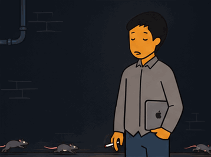
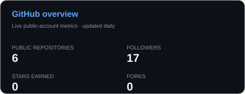
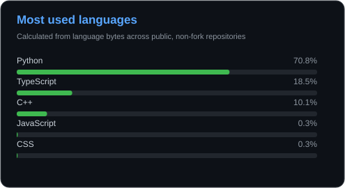
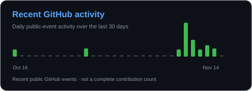

<!--
  Naveen Karthikeyan E | GitHub Profile README
  Profile README repository: naveen-elayaraja/naveen-elayaraja
-->

  
  
  

**Computer Science student · Developer · Open-source enthusiast**

**IIT-M x VIT**

---

## `$ whoami`

**Open source enthusiast**

## 🧰 My favorite tools and technologies

<table>
<tr>
<td align="center" width="12.5%"> Python</td>
<td align="center" width="12.5%"> Java</td>
<td align="center" width="12.5%"> C</td>
<td align="center" width="12.5%"> C++</td>
<td align="center" width="12.5%"> JavaScript</td>
<td align="center" width="12.5%"> TypeScript</td>
<td align="center" width="12.5%"> HTML</td>
<td align="center" width="12.5%"> CSS</td>
</tr>
<tr>
<td align="center"> React</td>
<td align="center"> Next.js</td>
<td align="center"> Tailwind CSS</td>
<td align="center"> Node.js</td>
<td align="center"> FastAPI</td>
<td align="center"> PostgreSQL</td>
<td align="center"> SQLite</td>
<td align="center"> MongoDB</td>
</tr>
<tr>
<td align="center"> Raspberry Pi</td>
<td align="center"> Arduino</td>
<td align="center"> OpenCV</td>
<td align="center"> Linux</td>
<td align="center"> Git</td>
<td align="center"> GitHub</td>
<td align="center"> VS Code</td>
<td align="center"> Postman</td>
</tr>
<tr>
<td align="center"> Apple</td>
<td align="center"> CoppeliaSim</td>
<td align="center"> Ubuntu</td>
<td></td><td></td><td></td><td></td><td></td>
</tr>
</table>

## 📊 GitHub stats & activity

**This snake survives on my late-night commits.**

## ☕ Let's build something worth staying up for

### Have an idea, a problem to solve, or an open-source project to build?

**Let's turn late-night conversations into real-world projects.**

  

